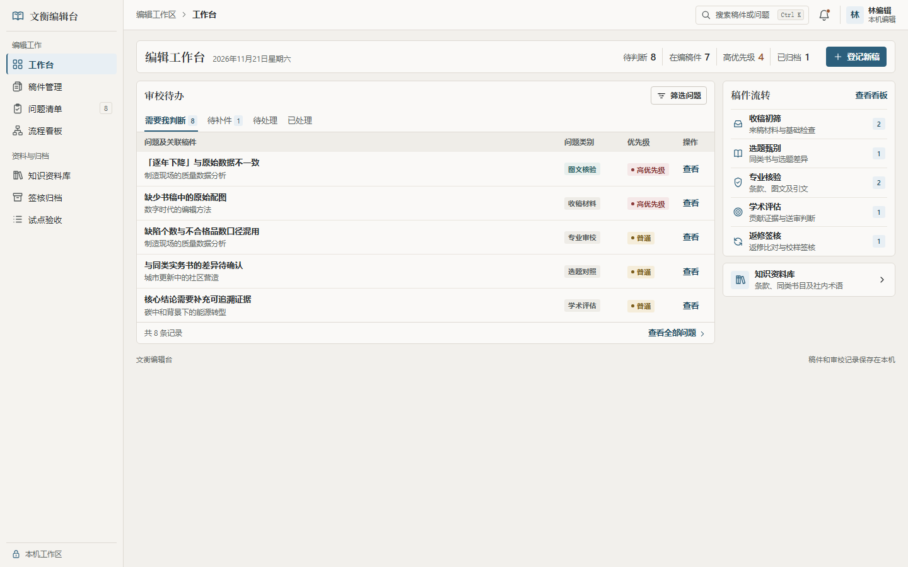

# 文衡编辑台

面向出版社编辑的本机审稿工作台。它把来稿、审校意见、条款证据和校样收在同一处，让编辑从「需要我判断」直接打开原文、核对依据，并把处理结果带到下一轮返修。



## 三分钟试用

需要 **Python 3.10+** 和现代浏览器。核心功能使用 Python 标准库和原生 JavaScript。

克隆仓库，或在 GitHub 仓库页面选择 **Code → Download ZIP**，解压后进入项目目录。

```sh
git clone https://github.com/JianP-Ciallo/wenheng-editorial-workflow.git
cd wenheng-editorial-workflow
```

Windows 用户可双击 `启动编辑台.cmd`。也可以在项目目录运行以下命令，再打开 [本机工作台](http://127.0.0.1:8000/)。

```sh
python -B server.py
```

1. 在首页打开示例问题「逐年下降」与原始数据不一致，查看稿件段落和图表证据。
2. 点「登记新稿」，填写基本信息，上传 DOCX 或 UTF-8 TXT。安装 Poppler 后也可上传 PDF。初筛完成后，在「问题清单」核对候选意见。
3. 从稿件详情查看原文、导出 Word 批注或上传返修版本。侧栏的「流程看板」可查看各稿所处节点。

首次启动附带虚构示例及演示资料。用 `--data <目录>` 可以单独创建试用工作区，用 `--port 8001` 可以更换端口。

## 最近更新

- **正文引文对照**。在稿件详情打开「条款与引文 → 正文与文末对照」，选择版本后逐条查看正文引文与文末条目。支持合并编号（如 `[2,3]`）和编号范围（如 `[4–6]`），改进了双栏 PDF 和 DOI 后紧接下一条文献的识别。对照结果可跳到原文所在段落或页码。
- **PDF 段落和图文核验**。按段落检查跨行的成对标点和重复内容，减少版面换行、页眉和重复示例标题造成的误报。支持识别附录图题，在「校样与图件」查看正文指代和图题位置。
- **分组审校与处置**。「问题清单」按「稿件 → 问题 → 出现位置」展开，可从每处记录回看原文。「处置依据」可选常用理由，也可填写补充说明。
- **稿件回收站**。从「稿件管理 → 回收站」可恢复稿件或永久删除。永久删除需确认，会清理当前工作区中的稿件附件、审校记录和关联任务。
- **版权核验**。在稿件详情逐项登记外来素材的来源、授权范围、期限和对应版本，导出待补证清单。签核前核对许可范围和最新校样版本。[查看版权核验流程](#版权核验)

## 从来稿到签核

| 阶段 | 可以完成的工作 |
| --- | --- |
| 收稿初筛 | 检查重复内容、常见错字和语法搭配、单位、编号、数据矛盾与引文编号。意见保留原文定位，可导出 Word 批注。相同低风险规则支持批量处理。 |
| 选题甄别 | 查找已审定的同类书目，记录覆盖范围和选题差异。对获准使用的 DOCX/TXT 全文查看重合片段、段落线索和逐句对齐。 |
| 专业核验 | 结合关键词和本地字符向量检索条款，按项目授权、适用时间、地区和对象过滤。查看条文、脚注、表行或公式，并把可回查的证据绑定到稿件段落。 |
| 学术评估 | 查阅稿件和对照摘录，填写研究问题、增量、证据和送审意见。对照正文引用与文末条目，可用 Crossref 查询公开 DOI。仅发送 DOI，字段差异供编辑复核。 |
| 返修签核 | 比较稿件版本，重跑受影响检查，处理补件与阻断事项。可查看 PDF 页内高亮、图文页距和图片有效 PPI，并对 CSV/XLSX 数据复算支持的总计和公式。 |

自动检查产生候选意见，由编辑确认。引文暂停加工依据编辑登记的独立来源，签核前须处置所有未结事项。

## 版权核验

从稿件详情进入「版权核验」。上传稿件后，网络来源、译自其他作品、转载和改绘等明确线索会进入清单，也可以手动登记正文引文或封面素材。每条事项可跳到关联版本的原文，并将需作者补交的材料汇总导出。

编辑登记原作品、权利人、依据及其位置、经手人和对应稿件版本，可关联本稿已上传的补件。拟用和许可范围按「媒介 / 用途」逐组填写。纸书内页与电子书封面是两个独立使用项。系统检查许可覆盖、截止日期和最新校样版本，适当引用、替换素材及疑难转审由编辑登记结论。既有图件核验备注可在更新记录时保留为历史。当前版本的版权事项完成后方可签核。

版本交接参考了 Open Monograph Press 的编辑流程。逐件许可、使用范围和期限记录参考了 ResourceSpace 与 W3C ODRL 的设计。 [Open Monograph Press](https://github.com/pkp/omp-user-guide/blob/main/en/editorial-workflow/copyediting.md) · [ResourceSpace License Manager](https://www.resourcespace.com/knowledge-base/plugins/license-manager) · [W3C ODRL](https://www.w3.org/TR/odrl-model/)

## 可选组件

| 功能 | 配置 |
| --- | --- |
| PDF 提取和预览 | 安装 Poppler，将 `pdftotext`、`pdftoppm` 等命令加入 PATH。 |
| 扫描件和图中数字 OCR | 安装本机 Tesseract 及中文、英文语言数据。低置信内容进入人工复核。 |
| 本机模型向量重排 | 安装 Ollama 和本地嵌入模型，设置 `EDITOR_EMBED_MODEL`。默认检索使用离线字符向量和领域同义词。 |
| 公开来源链接巡检 | 将允许检查的 HTTPS 域名填入 `EDITOR_SOURCE_HOSTS`，以逗号分隔。仅检查资料条目中已登记的无参数地址。 |

知网、万方及国标系统通过编辑部的人工回查渠道使用。复杂工程图、图件授权、地图审图号和正文语义均保留人工判断。

## 资料库、试点与权限

- **知识资料库**支持 CSV/XLSX 批量导入。Excel 使用第一张表。通用表头为 `type,title,source,projects,text`，术语加 `variant`，专业条款加 `identifier,edition,chapter,page,validFrom`。导入资料进入待审定区，项目列留空时使用表单中的默认授权。
- **试点验收**按稿件、编辑和日期统计准确率、误报、漏报与每万字工时。净节省按工时差额扣除经常费用和分摊固定投入。
- **账号与项目权限**可通过 `python -B server.py --init-admin admin` 启用。按终端提示设置初始口令后，启动服务并登录，在账号菜单配置成员角色和项目范围。操作审计记录标识、状态和耗时。

服务监听 `127.0.0.1`。数据库与上传附件默认保存在 `.editor-data/`。旧版 `workspace.json` 会在首次启动时导入 SQLite，源文件保留。

归档版本可在「原文与版本」登记保留期限。用 `python -B server.py --purge-expired` 预览待清理清单。确认对象后，可加 `--apply` 清除到期版本在当前工作区的原件和提取内容。旧 JSON、已下载文件及备份按本地保留制度单独处理。

## 项目结构

| 文件 | 职责 |
| --- | --- |
| `server.py` | 本机服务、审校接口与检查队列 |
| `workflow.py` | 五阶段流转、Word 解析、批注与版本差异 |
| `editorial_checks.py` | 校对规则、数值矛盾和引文对齐 |
| `proofs.py` | PDF/Word 校样、图件参数和表格复算 |
| `copyright_review.py` | 外来材料线索、人工版权处置、许可覆盖和版本复核 |
| `research.py` | 条款检索、证据回查、书目比对与 DOI 查询 |
| `workspace.py` | SQLite、账号权限、审计和试点指标 |
| `web/` | 编辑工作台前端 |

运行测试与前端语法检查。

```sh
python -B -m unittest -v
node --check web/app.js
node --check web/ui.js
node --check web/tools.js
node --check web/icons.js
```

## 许可证

项目代码采用 MIT 许可证。分发代码副本或实质性部分时，须保留版权和许可声明。工作台中上传的稿件和第三方材料依其各自的授权使用。[查看许可证全文](LICENSE)
